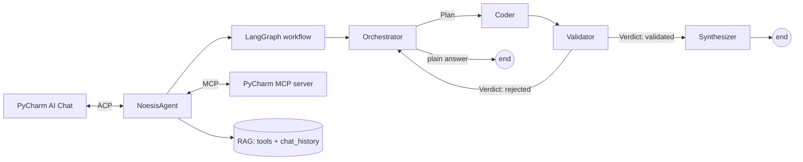

# Noesis

A multi-agent AI assistant that lives inside the **AI Chat panel of PyCharm**. It answers everyday questions directly, switches to a **plan → code → validate** workflow for harder tasks, and shows everything it does (reasoning, tool calls, results, context usage) live in the IDE through the **Agent Client Protocol (ACP)**.

It can use the **PyCharm MCP server** and **custom MCP servers**, and relies on a local **RAG** for two things: long-term memory about the user, and on-demand discovery of tools.

Everything runs locally with [Ollama](https://ollama.com): no paid account, no API cost, full privacy.

---

## Features

- **Native PyCharm integration**: runs as an ACP agent. Messages, reasoning ("thoughts"), tool calls with inputs/outputs, and token usage are streamed to the chat panel.
- **Adaptive behaviour**: simple questions are answered directly by the orchestrator; code tasks trigger a structured plan and a coder/validator loop.
- **Multi-agent workflow** built with LangGraph: orchestrator, coder, validator, synthesizer.
- **Dynamic tool discovery**: instead of loading every MCP tool into the model's context, the agent searches a tool catalog (RAG) and only activates the tools it needs (capped at `MAX_ACTIVE_DISCOVERED` per session).
- **Long-term memory**: facts and preferences about the user are stored and retrieved across conversations (`chat_history` collection).
- **Session history**: the last 10 turns and every tool result are passed back to the orchestrator, so it does not re-search what it already knows.
- **Bounded loops**: tool loops and validation retries have hard limits (`MAX_ITERATIONS`, per-agent tool iteration caps).

## Architecture




## The Agents

| Agent | Role | Tools |
|---|---|---|
| **Orchestrator** | Analyses the request. Answers directly, or submits a structured `Plan` (objective, coder instructions, validator instructions, acceptance criteria). | `search_memory`, `add_to_collection`, `update_collection`, `Plan` |
| **Coder** | Implements the plan's instructions. | Core tools + MCP tools discovered via RAG |
| **Validator** | Reviews, tests and audits the code, then submits a `Verdict` (`is_validated`, `feedback`). | Core tools + discovered MCP tools, `Verdict` |
| **Synthesizer** | Writes the final user-facing answer from the validated code. | None |

If the validator rejects the code, its feedback goes back to the orchestrator for a new plan, up to `MAX_ITERATIONS`.

## Core Tools

These three tools are always available; everything else is discovered at runtime.

| Tool | Purpose |
|---|---|
| `search_memory(query, collection, n_results, contains)` | Semantic search. `collection="tools"` finds and activates MCP tools; `collection="chat_history"` recalls long-term memories about the user. |
| `add_to_collection(document, id)` | Saves a new memory (fact, preference, summary). |
| `update_collection(document, id)` | Overwrites an existing memory. |

When `search_memory` is called on the `tools` collection, the matching tool schemas are converted to Ollama function definitions and added to the session's active tools. Calling a tool that has not been discovered returns an error telling the model to search first.

## Project Structure

| File | Content |
|---|---|
| `agent.py` | `NoesisAgent`: ACP lifecycle (initialize, sessions, prompt), MCP connection, tool routing, entry point. |
| `agent_workflow.py` | LangGraph workflow, agent prompts, `Plan` / `Verdict` schemas, tool loop, streaming to ACP. |
| `tools.py` | `CORE_TOOLS` definitions. |
| `RAG.py` | `rag` class (`search_memory`, `add_to_collection`, `update_collection`) and the `TOOLS` collection constant. |
| `config.py` | `LLM`, `MAX_CONTEXT_SIZE`, `MAX_ITERATIONS`, `MAX_ACTIVE_DISCOVERED`, `pycharm_MCP_URL`. |

## Requirements

- Python 3.11+
- PyCharm with AI Chat and ACP agent support
- Ollama running locally, with a model that supports tool calling and reasoning
- Python dependencies listed in `requirements.txt` (`acp`, `mcp`, `ollama`, `langgraph`, `langchain`, `pydantic`, etc.)

## Installation

```bash
git clone https://github.com/v-Ardent/acp-custom-local-multi-agent-pycharm.git
cd acp-custom-local-multi-agent-pycharm
pip install -r requirements.txt   # or conda env create -f environment.yaml
ollama pull <your-model>
```

## Configuration

Edit `config.py`:

| Setting | Meaning |
|---|---|
| `LLM` | Ollama model name used by every agent. |
| `MAX_CONTEXT_SIZE` | Context window (`num_ctx`), also used as the size in the usage meter. |
| `MAX_ITERATIONS` | Maximum plan/code/validate rounds before the workflow stops. |
| `MAX_ACTIVE_DISCOVERED` | Maximum number of discovered tools kept active per session (oldest are dropped first). |
| `pycharm_MCP_URL` | Fallback URL of the PyCharm MCP server. |

In PyCharm, enable the MCP server (**Settings → Tools → MCP Server**). The agent uses the HTTP server named `pycharm_MCP` passed by PyCharm when a session starts, and falls back to `pycharm_MCP_URL` otherwise.

## Running in PyCharm

1. Make sure Ollama is running locally.
2. Register Noesis as a custom ACP agent in PyCharm's AI Chat settings, with a command that launches the agent over stdio:

   ```json
   {
     "default_mcp_settings": {
       "use_idea_mcp": true,
       "use_custom_mcp": true
     },
     "agent_servers": {
       "Noesis": {
         "command": "C:\\path_to_env\\python.exe",
         "args": [
           "C:\\path_to_project\\PycharmProjects\\acp-custom-local-multi-agent-pycharm\\agent.py"
         ]
       }
     }
   }
   ```

3. Configure the MCP connection in PyCharm (File | Settings | AI | Air | MCP Servers | edit MCPs):

   ```json
   {
    "mcpServers": {
        "pycharm_mcp": {
            "type": "streamable-http",
            "url": "http://127.0.0.1:XXXXX/stream",
            "headers": {
                "IJ_MCP_SERVER_PROJECT_PATH": folder_path
            }
        }
    }

4. Open the AI Chat panel, select **Noesis**, and start a session.

## Usage Examples

- **Querying history:** *"What did we decide about the database last week?"*
  → The orchestrator searches `chat_history` and answers directly.
- **Saving preferences:** *"Remember that I prefer type-annotated Python."*
  → Saved into memory via `add_to_collection`.
- **Complex tasks:** *"Add pagination to the /users endpoint and make sure it is tested."*
  → The orchestrator discovers the needed tools, submits a plan, the coder implements it, the validator reviews it, and the synthesizer reports back.

## License & Disclaimer

Distributed under the MIT License.

**Disclaimer:** PyCharm is a registered trademark of JetBrains s.r.o. This project is an independent open-source tool and is not affiliated with, endorsed by, or sponsored by JetBrains or Ollama.
